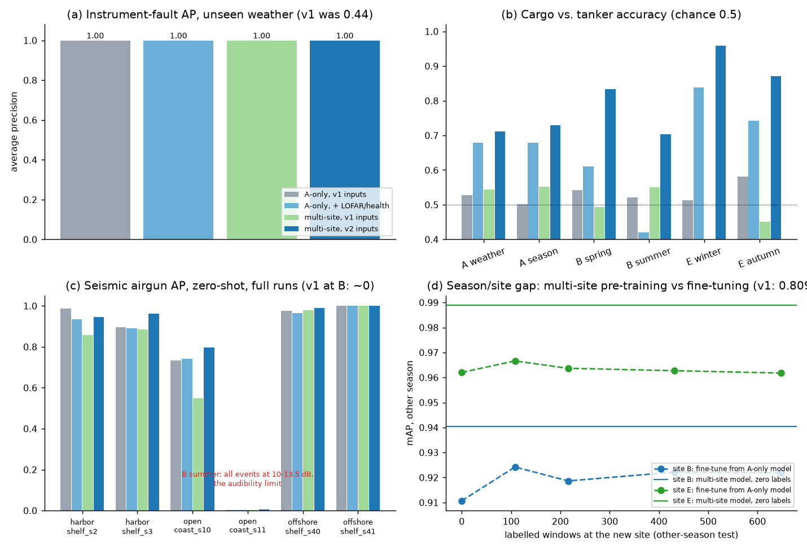
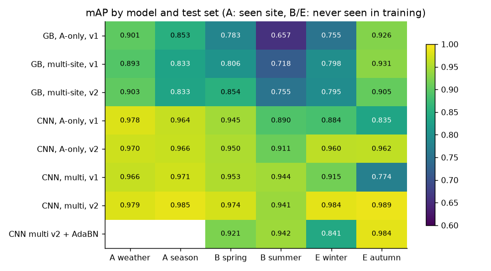
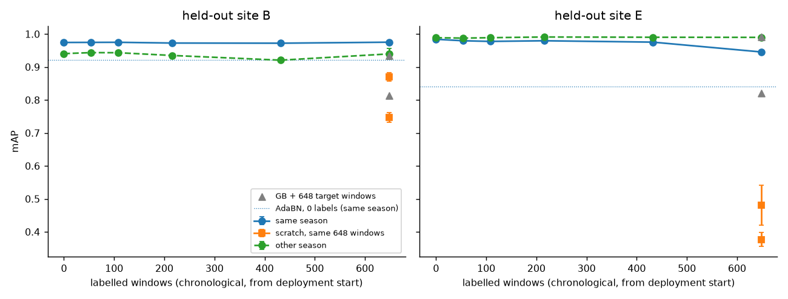
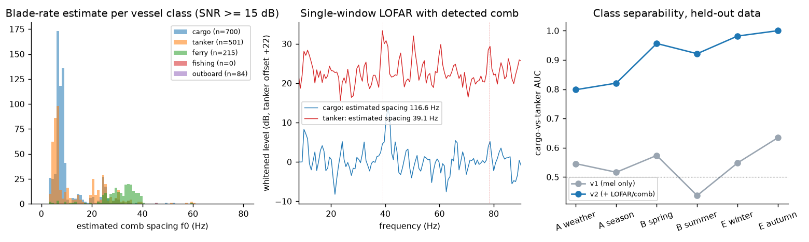
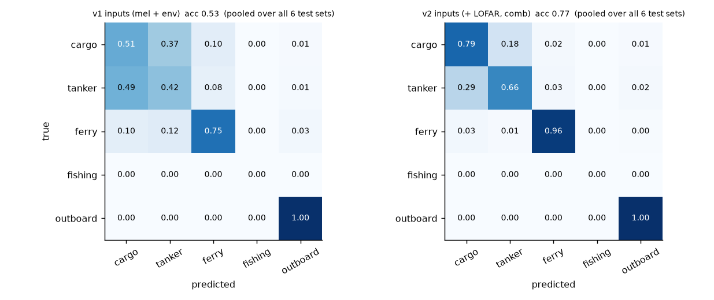
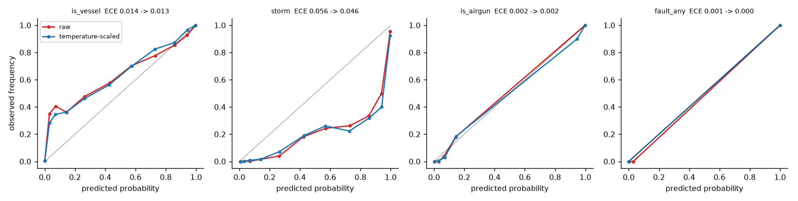
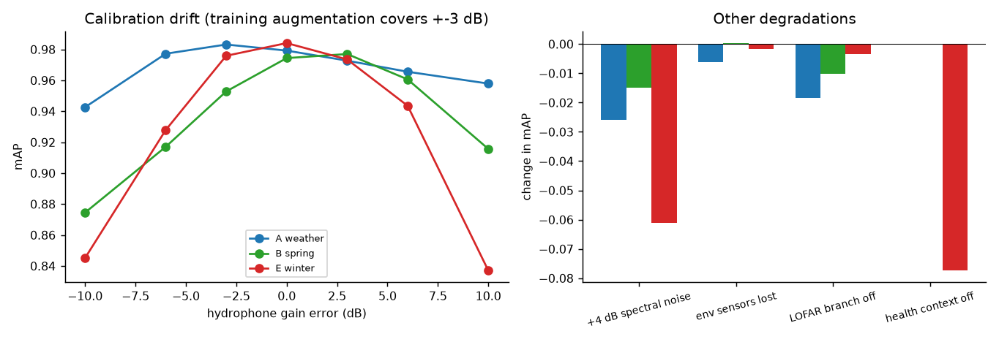

# Physics-based ocean simulator, detection and classification study

Second-generation simulation layer (the original toy generators in `simulation/data_generator/` are untouched).
Everything below is **synthetic** apart from one four-recording sanity check; numbers measure the pipeline on simulated
data, not real-world accuracy. See [Limitations](#limitations).



## What is modelled

| Layer | Module | Physics / behaviour |
|---|---|---|
| Acoustics | `physics.py` | Mackenzie sound speed; Ainslie-McColm absorption (T, S, **pH**, depth); practical spreading + shallow-water waveguide cutoff + thermocline penalty; Wenz/Coates ambient noise (wind, shipping, thermal, turbulence) + rain + tidal-flow noise; Ross vessel source levels |
| Atmosphere / ocean | `weather.py` | Solar geometry, synoptic fronts (wind, pressure, rain), fetch-limited waves, 4-harmonic tides + currents, SST relaxation, stratification, runoff -> salinity/turbidity/pH, diel photosynthesis pH, plankton bloom, O2. Five sites (20-110 m deep) |
| Living beings | `bio.py` | Snapping shrimp chorus (temperature, diel), fish chorus (spawning season, dusk), dolphin pods (dawn/dusk Markov arrivals, whistles + clicks), baleen whale song (seasonal passage) |
| Human sources | `anthro.py` | Vessel traffic (cargo, tanker, ferry, fishing, outboard) with CPA tracks, Doppler, blade-rate tonal comb + cavitation continuum; seismic airgun campaigns; instrument faults (50/60 Hz hum, dropout, cable pops, stuck env sensor) |
| Instruments | `scenario.py` | Hydrophone sensitivity + preamp + 16-bit ADC clipping, biofouling drift, env-sensor noise/spikes/drift/stuck |
| Labels | `scenario.py` | Per-source peak time-frequency SNR (>= 10 dB = audible), storm = wind>10.5 m/s or rain>2 mm/h or runoff>0.5, fault, `anomaly` = vessel + airgun + storm + fault |

Air is modelled only through wind, rain, pressure, air temperature and irradiance. Molecular-scale air dynamics have no
effect on a submerged sensor and are deliberately not simulated. Not modelled: full-wave/ray propagation, bathymetry,
Lloyd's-mirror interference, species call libraries (call shapes are generic).

## Corpus and protocol

17 runs, 5 s window every 10 min (4320 windows per 30-day run, ~6 h of audio each at 22.05 kHz), all rendered from
physics, deterministic per seed.

| Site | Depth | Role | Runs |
|---|---|---|---|
| A harbor shelf | 20 m | train (s0, s1) / test (s2 unseen weather, s3 unseen season) | 4 |
| C estuary bay | 32 m | train only (river-driven, busy) | 2 |
| D strait channel | 48 m | train only (cold, strong tides) | 2 |
| **B open coast** | 60 m | **held out**, spring + summer | 2 |
| **E offshore shelf** | 110 m | **held out**, winter + autumn | 2 |
| rich_* (A, C, D) | | event-rich training runs (forced airgun campaigns, many faults), 15 d | 5 |

Splits are chronological or by whole run, never random windows. Train = first 80 % of each training run, validation
(early stopping, thresholds, calibration) = last 20 %. At B and E the first 25 % of each run is reserved for
adaptation experiments and is excluded from the test slice (last 75 %). Every non-rich run contains a seismic survey so
airgun detection is evaluable at every site. Event counts per test slice are in `results/classification_results.json`
(`tests`); fault and airgun counts at B are small (6-15 fault windows), so those per-label numbers are noisy.

## Results

### Stage 3: supervised multi-label classification (mAP over 7 labels, zero-shot on unseen weather / season / sites)

| Model | A weather | A season | B spring | B summer | E winter | E autumn | mean |
|---|---|---|---|---|---|---|---|
| GB, A-only, original features | 0.901 | 0.853 | 0.783 | 0.657 | 0.755 | 0.926 | 0.813 |
| GB, multi-site, + health/comb features | 0.903 | 0.833 | 0.854 | 0.755 | 0.795 | 0.905 | 0.841 |
| CNN, A-only, mel + env (original design) | 0.978 | 0.964 | 0.945 | 0.890 | 0.884 | 0.835 | 0.916 |
| CNN, A-only, + LOFAR / sensor health | 0.970 | 0.966 | 0.950 | 0.911 | 0.960 | 0.962 | 0.953 |
| CNN, multi-site, mel + env | 0.966 | 0.971 | 0.953 | 0.944 | 0.915 | 0.774 | 0.921 |
| **CNN, multi-site, + LOFAR / sensor health** | **0.979** | **0.985** | **0.974** | **0.941** | **0.984** | **0.989** | **0.975** |

A = seen site, B and E = never seen in training. Day-block bootstrap 95 % CIs are in `results/bootstrap_results.json`
(e.g. B spring 0.974 [0.959, 0.982]; B summer 0.941 [0.822, 0.975], wide because that slice holds 31 storm windows).
Both ingredients are needed: the new inputs alone give +0.037 mean, multi-site training alone +0.004, together +0.059,
and the worst case improves from 0.835 to 0.941. Multi-site training with the old inputs is *worse* than A-only at E
autumn (0.774), so more training sites only help once the inputs carry the discriminating information.



### The four weak spots of the first version

| Weak spot (first version) | Diagnosis | Fix | Now |
|---|---|---|---|
| Fault AP 0.44 on unseen weather | audio faults (hum, pops, dropout) were already caught (AP ~1.0); the stuck-sensor fault is invisible to any single-window feature (22 of 39 fault windows scored ~0.002) | causal sensor-health context: run length of bit-identical readings, short-term variability | fault AP **1.00**; stuck-sensor recall at 1 % FPR 0.0 -> **1.0** (site E, the only test runs containing one) |
| Cargo vs. tanker indistinguishable (5-way acc 0.53) | 64 mel bands have 2-3 bins below 100 Hz and cannot resolve the 4-9 Hz blade-rate comb | 32768-point narrowband LOFAR (0.67 Hz bins), running-median whitening, autocorrelation comb estimator, 1-D LOFAR branch; cargo/tanker shaft ranges made to overlap slightly | cargo-vs-tanker accuracy ~0.5 (chance) -> **0.70-0.96** (AUC 0.80-1.00); 5-way 0.53 -> **0.74-0.96**; vessel family (merchant/ferry/outboard) 0.96-1.00 |
| Airgun AP ~0 at the new site | no low-SNR airgun examples in training, none in the test slice | campaign in every run, range 8-60 km, multi-site training | AP **0.80** (B spring), **0.99 / 1.00** (E), 0.94-0.96 (A); see caveat below |
| Fine-tuning gained only 0.809 -> 0.837 across seasons | training data covered one season at one site | domain-randomised training (3 sites, 4 seasons) | other-season mAP **0.941** (B) and **0.989** (E) with **zero** target labels |



Remaining caveats, stated plainly:

* **Airgun at B summer is still ~0.** All 35 events there are at 10.3-13.5 dB peak SNR, i.e. at the audibility limit used
  for the label. Recall at 1 % FPR by SNR stratum (main model, all six test runs): 10-12 dB 0.56, 12-14 dB 0.67, >= 14 dB 0.98.
  Adding explicit low-frequency impulse features to gradient boosting raised airgun AP at A from 0.57 to 0.96 but left B summer at
  0.004, so this is a detection-limit effect, not something a feature fixes.
* **Fine-tuning no longer helps much.** Zero-shot is near the ceiling, so 54-648 labelled windows change mAP by less than +-0.01
  (B), and at E 648 spring windows slightly *hurt* the same-season score (0.984 -> 0.946, negative transfer). Fine-tuning
  from the weaker A-only pre-training gains +0.01 at B (0.911 -> 0.922) and nothing at E. Training from scratch on the same windows
  is far worse (0.75 / 0.87 at B, 0.48 / 0.38 at E). **AdaBN** (unlabeled BatchNorm re-estimation) hurts storm detection (E winter storm AP 0.94 -> 0.24), so it is not recommended here.
* **Vessel type is physically capped.** With only the true blade rate, the Bayes-optimal cargo-vs-tanker accuracy at passage level is 0.88
  (the two classes' blade-rate ranges overlap by design). Accuracy is audibility-dependent: 0.74 (10-15 dB SNR), 0.81 (15-20), 0.83 (20-30).
  Fishing boats are never audible at the 10 dB criterion in any run, so that class is empty in the labels.
* **Storm AP at B summer is 0.74** on only 31 positive windows; the label is a threshold on continuous wind/rain, so windows at 9-11 m/s are
  acoustically identical either side of the line (excluding +-1 m/s of the threshold raises AP to 0.98-1.00 on the full runs).
* Calibration: raw probabilities are already close for vessel/airgun/fault (ECE 0.00-0.014); storm is over-confident (ECE 0.056, 0.046 after
  temperature scaling), again because of the thresholded label.





### Robustness of the main model (A weather / B spring / E winter test slices)

| Perturbation | mAP change |
|---|---|
| hydrophone gain error +-3 dB (inside the training augmentation) | -0.02 ... +0.00 |
| gain error +-6 dB | up to -0.06 (B -6 dB: 0.974 -> 0.917) |
| gain error +-10 dB | -0.04 ... -0.15 (E +10 dB: 0.984 -> 0.837) |
| +4 dB spectral noise on the log-mel | -0.01 ... -0.06 |
| all environmental sensors lost (set to training median) | -0.006 ... +0.001 (acoustics carry the labels) |
| LOFAR branch disabled | -0.018 ... -0.003 |
| sensor-health context disabled | 0.000 (A, B), **-0.077** at E (the site with stuck-sensor episodes) |



Practical reading: an uncalibrated sensitivity error beyond ~6 dB costs real accuracy, so field calibration against a reference
tone matters; losing the environmental channels costs almost nothing for these labels.

### Stage 2: unsupervised anomaly detection (3-day self-calibration, tuned on dev run s2, tested on 5 unseen runs)

| Method | AUROC | AUPRC | F1 |
|---|---|---|---|
| M0 existing IF, 34 acoustic + 8 env | 0.707 | 0.394 | 0.427 |
| M1 IF, calibrated band levels + tonality + clock | 0.763 | 0.471 | 0.455 |
| **M6 self-cleaned IF (trimmed refit)** | **0.773** | **0.494** | **0.521** |
| M3 Mahalanobis / M4 autoencoder / M5 ensemble | 0.62-0.66 | 0.36-0.41 | 0.35-0.36 |
| Supervised ceiling (labelled, other runs) | 0.993 | 0.986 | 0.940 |

With realistic prevalence (vessels 2-25 % of windows, storms 0-27 %) "normal" is not rare, and the self-calibration window is
itself contaminated, so label-free detection saturates near AUPRC 0.5; labelled data closes the gap (hence Stage 3).
Calibrating on a clean window would give F1 0.49 vs 0.52 contaminated, so contamination is not the only limit.

### Edge feasibility (host timings, one CPU thread; Pi figures not measured)

Per window: conditioning 9 ms, classic features 14 ms, calibrated extras 5 ms, LOFAR + comb 5 ms, log-mel 2 ms, CNN forward 6 ms:
**41 ms total**, 0.34 M parameters (1.4 MB fp32; width-12 variant 0.10 M / 0.4 MB, 3 ms). Even 10x slower hardware uses 0.07 % of the 10-minute duty cycle.

### Sanity check on real ship recordings (ShipsEar sample set, 4 files)

`scripts/ocean_real_check.py`; recordings are uncalibrated, so one global gain aligns the noise floor to the simulator.
It is a smoke test, not validation.

| Recording | Mean vessel prob. | Windows flagged vessel | Storm prob. |
|---|---|---|---|
| passenger / ro-ro vessel manoeuvring | 0.98 | 100 % | 0.01 |
| small motorboat (zodiac) | 0.80 | 89 % | 0.55 |
| passenger ferry arriving (5 min, vessel not always near) | 0.28 | 32 % | 0.67 |
| rain, no vessel | 0.00 | 0 % | 0.99 (rain is in the storm label) |

The real spectra have a wider dynamic range than the simulated calm/vessel windows (5th-95th percentile -49...-1 dB vs. -34...-17 dB),
a visible sim-to-real gap. The comb estimator output on real ships was not interpretable without ground truth and is not claimed.

## Run

```
python simulation/scripts/ocean_generate.py        # corpus, 17 runs (~45 min on 16 cores)
python simulation/scripts/ocean_detect.py          # Stage 2 (~20 min)
python simulation/scripts/ocean_classify.py        # Stage 3 grid + adaptation (~3 h on CPU); --smoke for a code-path test
python simulation/scripts/ocean_eval_extra.py      # full-run airgun, SNR strata, FT from A-only, Bayes bound
python simulation/scripts/ocean_bootstrap.py       # day-block bootstrap CIs
python simulation/scripts/ocean_robustness.py      # gain drift, noise, sensor outage, disabled branches
python simulation/scripts/ocean_edge_benchmark.py
python simulation/scripts/ocean_real_check.py --data <dir with ShipsEar samples.zip extracted>
python simulation/scripts/ocean_render.py && python simulation/scripts/ocean_figures_v2.py
pytest simulation/ocean/tests
```

Generated data and the full `output/` tree are git-ignored; `results/` and `figures/` here are the committed snapshot
of the JSON results and key figures.

## Limitations

* Synthetic data: sources, propagation and the sensor chain are simplified models written by the same author as the classifier,
  so success here shows the pipeline can learn the simulated physics, not that it will generalise to a real hydrophone.
* One real-data smoke test with four uncalibrated files; no real-data training or evaluation.
* Held-out sites are different parameterisations of the same simulator, not different simulators.
* Labels are thresholds on simulator truth (audibility 10 dB, storm wind/rain/runoff), so the boundary cases are ambiguous by construction.
* Small event counts for faults and airgun at some test slices; compare the bootstrap CIs before reading differences below ~0.02.
* Stage 2 is evaluated on a fixed list of 5 runs (A s0, s1, s3 and B s10, s11); the other runs are not scored there.
